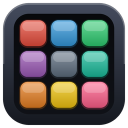

# DeckHand



A small Rust system-tray app that drives an Elgato Stream Deck (15-key) **without
the Elgato software**. Keys are set up in a plain `config.toml`. Each key gets a
label, a colour, an icon and an action: a hotkey, typed text, or a program to launch.

The default layout covers cut/copy/paste, undo/redo and screen capture (snip,
full screen, window, record).

## Features

- Icons from your own PNG/JPG files, or from the built-in Windows *Segoe Fluent Icons* font
- Edit `config.toml` while it runs and the deck redraws instantly
- System tray menu: edit config, open icons folder, reload, view log,
  pause, **Start with Windows**, quit
- Reconnects automatically if the deck is unplugged
- Single instance
- Can be controlled from other programs (`--pause`, `--resume`, `--quit`, `--status`),
  so another app can borrow the deck. See [CONTROL.md](CONTROL.md)

## Build

Needs Rust (MSVC toolchain) on Windows.

```powershell
cargo build --release
Copy-Item target\release\deckhand.exe DeckHand.exe
.\DeckHand.exe
```

Quit the Elgato Stream Deck app first, because only one program can own the device.
`cargo run` gives a debug build with a console window, which helps when debugging.

## Configuring keys

Keys are numbered 0–14, left to right and top to bottom:

```
 0  1  2  3  4
 5  6  7  8  9
10 11 12 13 14
```

```toml
[[button]]
key = 8
label = "My Thing"
color = "#1abc9c"
icon = "icons/mything.png"      # or: glyph = "E722"
action = { type = "hotkey", keys = "ctrl+shift+s" }
# { type = "text", text = "hello" }   { type = "run", command = "notepad" }
```

Hotkeys can combine `ctrl`, `shift`, `alt` and `win` with letters, digits,
`f1`–`f24`, `printscreen`, `enter`, `tab`, `esc`, `delete`, the arrow keys and so on.

## Icon

The app icon is generated by `cargo run --bin make_icon`, which writes
`assets/icon.png` and `assets/icon.ico`.
